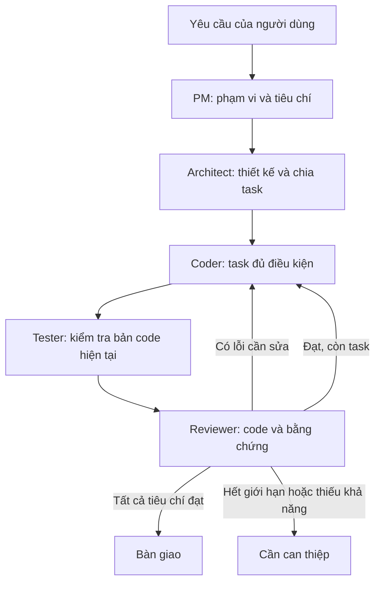

# Thiết kế nhóm AI build phần mềm cho Multi-Agent Hub

Ngày: 13/10/2026. Trạng thái: bản đề xuất ban đầu, được điều chỉnh khi triển khai 5.0.

**Điều chỉnh theo phản hồi:** vai trò là chuyên môn ngang hàng. Bản 5.0 dùng bàn tròn ↔ task ↔ phân tích kiểm tra/review, có thể quay lại bàn tròn; không khóa vào PM → Architect → Coder. Trạng thái nhóm được lưu trong JobRecord/JSON hội thoại thay vì kho WorkflowStore riêng. Xem [kiến trúc thực tế](ARCHITECTURE.md) và [hướng dẫn](TEAM_USER_GUIDE.md) cho hành vi đã triển khai; phần còn lại dưới đây là tài liệu quyết định ban đầu, không phải cam kết mọi mục đã có.

## 1. Quyết định đề xuất

Giữ giao diện desktop C# và các kết nối CLI/API hiện tại. Thêm chế độ **Nhóm phát triển** bên cạnh Cùng làm việc và Bàn luận. Tham khảo cách MetaGPT yêu cầu đầu ra rõ ràng cho từng vai trò; xây bộ điều phối nhỏ trong C# trước khi cân nhắc phụ thuộc framework.

Mục tiêu là tạo một phiên phát triển có yêu cầu, kế hoạch, task, code, bằng chứng kiểm tra và bàn giao. Số lượng lời trao đổi hoặc sự đồng ý của các model không được dùng làm tiêu chí hoàn tất.

### Đối chiếu nguồn

- [MetaGPT](https://github.com/FoundationAgents/MetaGPT) tổ chức các vai trò và SOP, tạo yêu cầu, thiết kế, API và tài liệu. Đây là hướng phù hợp để tham khảo quy trình của Hub.
- [ChatDev](https://github.com/OpenBMB/ChatDev) hiện là ChatDev 2.0 DevAll, nền tảng điều phối có thể cấu hình; mô tả công ty phần mềm ảo cổ điển thuộc nhánh ChatDev 1.0. Không nên coi mô tả waterfall cũ là toàn bộ kiến trúc hiện nay.
- [AutoGen](https://github.com/microsoft/autogen) hiện ở maintenance mode. Nếu chọn framework mới của Microsoft, nên đánh giá [Microsoft Agent Framework](https://github.com/microsoft/agent-framework), có C#/.NET và workflow dạng đồ thị. Chưa có cơ sở coi framework này là kết nối sẵn cho Codex CLI hoặc Antigravity CLI; vẫn cần adapter và thử nghiệm riêng.

Đây là đánh giá thiết kế cho Hub, không phải kết quả benchmark các framework.

## 2. Hub hiện có và còn thiếu gì

| Thành phần | Hiện tại | Phần cần thêm |
|---|---|---|
| Kết nối model | CLI, API, sao chép/dán; cấu hình model và Instructions | Khai báo khả năng thực tế: chỉ trả lời, đọc file, sửa file, chạy lệnh |
| Vai trò | Văn bản hướng dẫn trong AgentConfig | Vai trò có ID, đầu vào, đầu ra và quyền riêng |
| Điều phối | Song song, lần lượt, cộng tác có lượt hoàn thiện, bàn luận | Chuyển bước theo kết quả được kiểm tra; task và phụ thuộc |
| Lịch sử | JobRecord, DiscussionTurn, thư viện hội thoại, TXT | WorkflowRun, task, artifact, lần thử và checkpoint theo bước |
| Kiểm tra | Model có thể báo đã chạy test qua CLI | Bằng chứng lệnh, exit code, log và phiên bản workspace được kiểm tra |
| Quota | Bỏ tích đúng agent; các chế độ hiện tại có thể tiếp tục | Chuyển vai trò sang kết nối dự phòng đủ khả năng; giữ nguyên bước bắt buộc |

Điểm mở rộng chính: `src-core/Models.cs`, `JobRunner.cs`, `Storage.cs`, `Conversations.cs`; giao diện ở `MainWindow.cs`, `ConversationCanvas.cs`, `AgentEditor.cs`.

ApiTransport hiện chủ yếu gửi prompt và nhận văn bản. API model không tự có quyền sửa file hoặc chạy test chỉ vì được gán vai Coder. Cần tool executor riêng hoặc giao task thực thi cho CLI có khả năng phù hợp. Kết nối thủ công phải hiện Chờ người dùng và không đủ điều kiện chạy tự động qua đêm.

## 3. Tách kết nối, vai trò và task

**Kết nối** là cách gọi công cụ: Codex CLI, Antigravity CLI, Claude Code CLI, API hoặc thủ công. **Vai trò** là trách nhiệm trong workflow. **Task** là đơn vị công việc cụ thể có tiêu chí nghiệm thu.

Một kết nối có thể đảm nhiệm nhiều vai trò. Với hai kết nối, ví dụ phân công ban đầu:

| Vai trò | Kết nối ví dụ | Đầu ra bắt buộc |
|---|---|---|
| Product Manager | Antigravity | Phạm vi, giả định, tiêu chí nghiệm thu |
| Architect | Codex | Kiến trúc, hợp đồng giao tiếp, danh sách task và phụ thuộc |
| Coder | Codex | Thay đổi mã nguồn và ghi nhận task đã xử lý |
| Tester | Antigravity hoặc CLI đủ khả năng | Kế hoạch test, bằng chứng thực thi, lỗi có cách tái hiện |
| Reviewer | Antigravity | Nhận xét gắn với file/dòng hoặc tiêu chí; kết luận có cấu trúc |

Đây là ví dụ phân công, không phải xếp hạng chất lượng model. Mỗi vai trò chọn được kết nối/model và fallback riêng. Model chọn theo danh sách được tài khoản thực tế hỗ trợ.

Không thay Instructions toàn cục mỗi lần đổi vai. Tạo bản cấu hình cho từng lần gọi, ghép vai trò với hướng dẫn của người dùng; lưu cấu hình hiệu lực vào lần thử để xem lại.

## 4. Luồng thực thi và điều kiện hoàn tất

Bộ điều phối quyết định thứ tự bằng trạng thái và quy tắc. Model đề xuất task, phụ thuộc và sửa đổi; Hub kiểm tra schema, ID, chu trình phụ thuộc và giới hạn trước khi nhận. V1 không cần thêm một Manager model luôn chạy.

Đầu ra gồm phần giải thích và khối dữ liệu có cấu trúc: artifact IDs, task IDs, trạng thái, lỗi, tiêu chí liên quan. Nếu sai định dạng, cho một lần sửa định dạng trong ngân sách; vẫn sai thì dừng bước. Không diễn giải chữ “PASS” nằm trong đoạn văn thành bằng chứng test đạt.

Task: `pending → ready → running → verifying → done`; có nhánh `needs_changes`, `blocked`, `cancelled`. Một task chỉ ready khi các task phụ thuộc đã done.

Điều kiện bàn giao: mọi task bắt buộc hoàn tất, build/test bắt buộc có kết quả đạt trên đúng bản workspace cuối, reviewer không còn lỗi chặn, các tiêu chí chưa kiểm chứng được ghi rõ. Thiếu SDK hoặc không chạy được test phải hiện **Chưa kiểm chứng**, không ghi thành thành công.

Giới hạn khởi đầu đề xuất: 2 vòng sửa cho mỗi task, 30 lần gọi model và 120 phút cho một phiên; chỉnh được trước khi chạy. Các lần lỗi, sửa schema, fallback và tổng hợp đều tính vào ngân sách. Với N task, luồng cơ bản dùng khoảng `2 + 3N + 1` lần gọi; mỗi vòng Coder/Tester/Reviewer thêm tối đa 3 lần gọi, chưa kể fallback. Đây là dự toán số lần gọi, không phải chi phí tiền/token.

## 5. Workspace, bằng chứng và khôi phục

V1 chạy một task ghi file tại một thời điểm. Hai model cùng tham gia dự án không đồng nghĩa hai tiến trình cùng sửa một file. Khi cần tăng tốc, có thể chạy các reviewer chỉ đọc đồng thời sau khi bản code đã ổn định.

Trước phiên, ghi nhận trạng thái workspace và thay đổi sẵn có. Không tự reset, xóa hoặc đè thay đổi của người dùng. Nếu có Git, lưu base commit và dấu vết diff; nếu chưa có Git, lưu manifest/hash của file liên quan. Chưa tự commit/push. Worktree cho nhiều coder là giai đoạn sau, cần xử lý cả checkout bẩn và hợp nhất xung đột.

Quyền theo vai trò là chính sách mong muốn; adapter phải xác nhận CLI có thể áp dụng. PM/Architect/Reviewer ưu tiên chỉ đọc; Coder cần ghi workspace. Tester chạy lệnh có thể tạo output hoặc fixture, nên không đánh đồng chạy test với quyền chỉ đọc. Custom CLI không có sandbox do Hub đảm bảo. UI hiển thị khả năng chưa được kiểm chứng thay vì hứa cách ly tuyệt đối.

TestRunner của Hub lưu executable, danh sách đối số, cwd, thời gian, exit code và log. Cấu hình lệnh lấy từ project hoặc bước chuẩn bị; đề xuất lệnh mới từ model hiện để người dùng cấu hình trước khi chạy. Không chạy trực tiếp chuỗi shell bất kỳ trích từ hội thoại. Lệnh build/test vẫn có thể thực thi script của project, nên phải dùng project người dùng chọn và cấu hình tin cậy.

Mỗi lần kiểm tra gắn với revision hoặc fingerprint của workspace. Sửa code sau khi test phải làm hết hiệu lực kết quả test liên quan. Exit code 0 chưa đủ nếu không tìm thấy test hoặc bộ kiểm tra không bao phủ tiêu chí bắt buộc.

Hết quota: bỏ chọn kết nối đó như hiện tại, loại khỏi các vai trò của phiên và thử fallback đủ khả năng trong ngân sách. Không bỏ qua Tester/Reviewer chỉ để pipeline kết thúc. Nếu còn một kết nối, chạy các vai tuần tự và ghi rõ tự review; nếu kết nối còn lại không thể sửa code/chạy lệnh thì chặn bước tương ứng.

Lỗi giữa lúc sửa code có thể để lại thay đổi một phần. Fallback đọc lại workspace và bằng chứng trước khi tiếp nhận task, không gửi lại mù quáng toàn bộ thao tác. Khi app đóng bất ngờ, đánh dấu lần đang chạy là interrupted; tiếp tục bằng thao tác của người dùng. Không tự phát lại lệnh có tác dụng phụ chỉ vì thiếu checkpoint cuối.

## 6. Cấu trúc C# và lưu trữ đề xuất

Giữ IAgentExecutor làm adapter gọi model; tách workflow khỏi các nhánh hiện có trong JobRunner.

| Thành phần mới | Trách nhiệm |
|---|---|
| TeamProfile / RoleBinding | Ánh xạ vai trò → kết nối/model, fallback, quyền |
| WorkflowRun / TaskRecord | Trạng thái phiên, task, phụ thuộc, ngân sách |
| StepAttempt | Vai trò, kết nối/model hiệu lực, prompt, kết quả, lỗi, số lần thử |
| ArtifactRecord | Loại đầu ra, task/lần thử tạo ra, phiên bản, đường dẫn, hash |
| WorkflowEngine | Chọn bước, kiểm tra điều kiện, sửa lỗi, quota, dừng |
| WorkspaceCoordinator | Khóa ghi file, fingerprint, phát hiện thay đổi |
| TestRunner | Chạy cấu hình kiểm tra và thu bằng chứng |
| WorkflowStore | Snapshot nguyên tử, checkpoint và nhật ký sự kiện |

Lưu trạng thái trong `%LOCALAPPDATA%\MultiAgentHub\workflows\<run-id>\`, liên kết với conversation ID và project. Trạng thái máy đọc dùng JSON có schemaVersion; TXT/Markdown là bản xuất để xem. Tài liệu bàn giao có thể xuất vào `docs/` của project khi người dùng chọn; code vẫn nằm trong workspace.

Artifact path phải ở trong thư mục cho phép, kiểm tra cả liên kết filesystem. Tách dữ liệu phiên/credentials khỏi file cấu hình nhóm có thể đưa lên Git. Không lưu API key trong snapshot hoặc log. Khi nâng phiên bản, config cũ vẫn mở và bốn chế độ hiện tại vẫn dùng như trước.

## 7. Giao diện và thứ tự triển khai

Giữ màn hình chat hiện tại. Chọn **Nhóm phát triển** tại bộ chọn điều phối; mở **Phân vai** để chọn model cho năm vai, fallback và giới hạn. Không bắt thêm năm kết nối để có năm vai.

Ở khu vực nội dung có ba góc xem: **Hội thoại**, **Công việc**, **Đầu ra & kiểm tra**. Hội thoại hiển thị vai trò cùng model; Công việc hiển thị task, phụ thuộc và bước đang chạy; Đầu ra hiển thị PRD, thiết kế, diff, lệnh kiểm tra và log. Tiến độ ghi “3/8 task đạt” thay vì phần trăm suy đoán.

Người dùng có thể gửi bổ sung yêu cầu, yêu cầu dừng sau bước hiện tại hoặc hủy ngay. Yêu cầu bổ sung tạo phiên bản phạm vi mới và được áp dụng ở ranh giới bước; không sửa prompt đang chạy. Thay đổi phạm vi làm đánh giá lại task và bằng chứng bị ảnh hưởng.

Triển khai theo thứ tự:

1. Tách vai trò khỏi kết nối; thêm TeamProfile, task, artifact và schema. Có kiểm tra đầu ra và lưu/khôi phục.
2. Workflow cố định PM → Architect → Coder → Tester → Reviewer; một writer, TestRunner, tối đa hai vòng sửa, quota fallback.
3. Giao diện phân vai, task, đầu ra, kiểm tra; liên kết với chat/TXT hiện có. Test đầu cuối bằng CLI giả lập, rồi smoke test kết nối thật do người dùng cấu hình.
4. Sau khi luồng tuần tự ổn định mới thêm nhiều coder, worktree và hội thoại nhóm tự chọn người phát biểu.

Các kiểm tra bắt buộc: một model đóng nhiều vai; quota không làm bỏ bước bắt buộc; task phụ thuộc không chạy sớm; schema lỗi không bị coi là đạt; test bị hết hiệu lực sau sửa code; timeout/hủy giữ dữ liệu; crash không phát lại lệnh; đường dẫn thoát workspace bị từ chối; config và lịch sử 4.0 vẫn đọc được.

V1 nên bắt đầu với project nhỏ có bộ build/test rõ ràng. Mức tự động hóa tăng theo độ ổn định của kết nối, công cụ thực thi và tiêu chí kiểm chứng; chưa thể hứa mọi prompt sẽ tạo ra phần mềm hoàn chỉnh chỉ bằng cách thêm vai trò.
